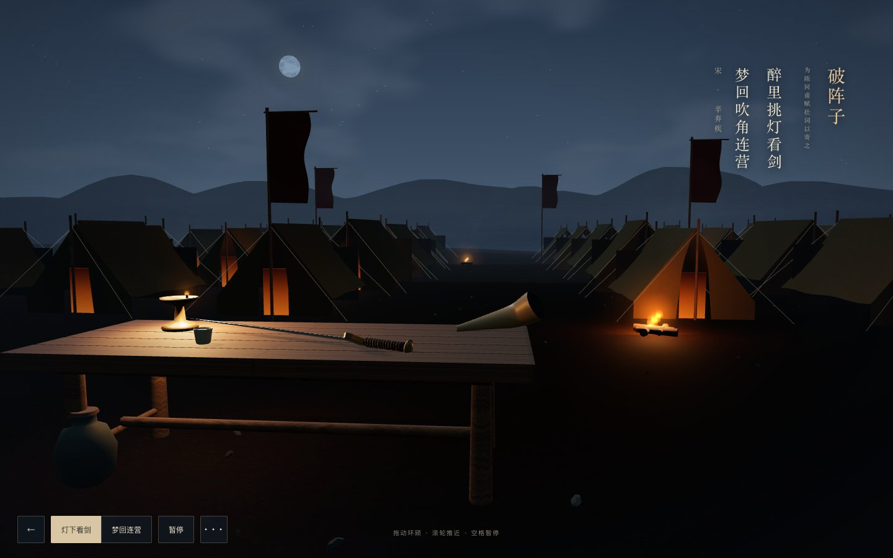
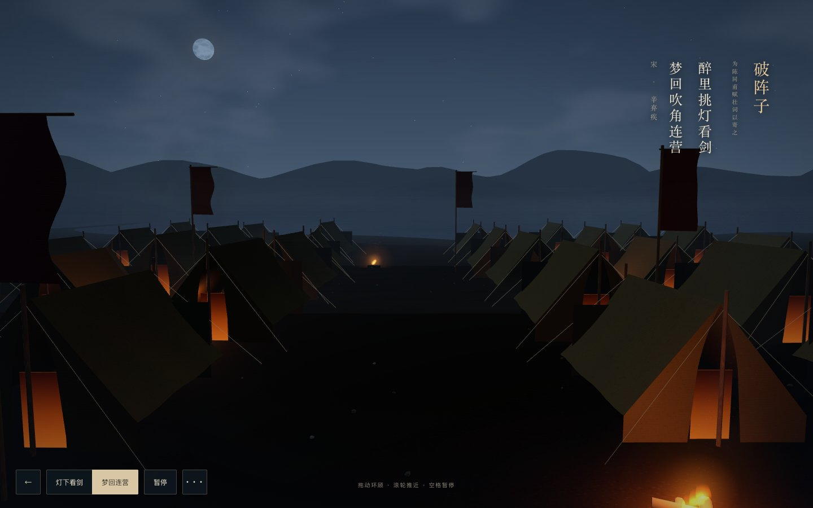

# 《破阵子》three.js 重写

2026-10-30，按用户「放弃旧版、用 three.js 重写」的指示独立完成。本次模型为 GPT-6（Codex），没有委派其他代理。

## 当前版本

- 诗文 ID：`pozhenzi`，版本：`lamp-and-dream`，题名：挑灯入梦 · 连营秋夜。
- 成品：`scenes/pozhenzi/lamp-and-dream.html`，维护源码：`scenes/pozhenzi/threejs/`。
- 旧 `lamplight-sword` 从当前馆藏和代码中撤下；旧实现可在 `f45735a` 及之前的 Git 历史中查阅。旧展厅的 `scene=lamplight-sword` 链接会回到现有新版本。
- `sceneStatus` 与版本状态仍为 `prototype`，原文仍为「待版本校勘」。没有将本次制作当作古籍校勘。

文学依据沿用馆藏电子文本及既有出处：「醉里挑灯看剑，梦回吹角连营」。油灯、长剑、号角、连营与旌旗对应诗句意象；月色、山形、器物造型与营地布局均为艺术加工，不声称宋代军营的历史复原。

## 画面与实现

近景为油灯照亮的木案、金属长剑、杯盏与号角，帐外以营火、布帐、旌旗、远山和夜雾形成纵深。保留诗题、作者与摘句，支持灯下／连营视点、拖动环顾、滚轮推近、暂停、画质和归位。少用按钮，把画质与归位放进更多选项。

three.js r160 使用官方发行文件，MIT 许可与库均嵌入成品。木器和金属使用 Standard 材质，布帐和地面使用带凹凸贴图的光照材质，远山使用漫反射材质；贴图全部由 Canvas2D 程序化生成，不引用外部图片。木构件烘焙合批，营帐、火焰、光晕和烟雾使用实例绘制。移动端限制像素比、地形、营帐、旗帜及粒子数量。




## 实测与检查

实际执行并通过：

```text
node scripts/validate.mjs
node scripts/test-agent-prompt.mjs
node scripts/test-gallery.mjs
node scripts/pack-pozhenzi-three.mjs --check
git diff --check
```

浏览器为 Playwright CLI 0.1.22 驱动的 Chromium 156.0.8078.76。隔离上下文、单实例测量，浏览器已经运行，可能已有 GPU 编译缓存：

| 环境 | 浏览视口 / DPR | 实际画布 | 运行采样 | 灯下绘制调用 | 首帧提交时刻 |
| --- | --- | --- | --- | --- | --- |
| 桌面 | 1440×900 / 1 | 1440×900 | 约 60 FPS | 48 | 约 1168 ms |
| 触控移动模拟 | 390×844 / 3 | 390×844 | 约 60 FPS | 45 | 约 352 ms |

首帧提交时刻由浏览器 Performance 标记记录，截图另外确认真实画面。它不等同于冷启动保证。长期运行的自动化窗口中也曾观察到较低帧率和更长初始化时间；表格仅是明确隔离环境的本机结果，不代表所有窗口状态、显卡或真实手机性能。

实际浏览器验证：

- 断网 `file://` 打开，three.js 渲染器实例和 r160 版本可核对；没有 HTTP 请求。
- 桌面鼠标拖动、DPR 3 移动模拟的原生触控拖动，都使实际渲染相机旋转；灯下／连营切换使相机位置真实改变。
- 暂停后场景时间停止，恢复后继续；画质改变实际画布尺寸，归位可用。
- WebGL 1 回退编译并出画；模拟上下文丢失后有可见错误，重新入境可恢复；无 WebGL 时有说明和重试入口。
- `prefers-reduced-motion` 下先画出完整首帧，再保持静止。
- 展厅只列新版，旧版本查询链接回到新版；离开视口停止更新，重新进入后继续。
- 首页隐藏重复工具栏，iframe 内 H、Esc 和空格快捷键正常。
- `/Poetic-Realms/` 子目录资源正常；320px 视口的控制按钮未越界且保持至少 44px 高度。

正常流程没有控制台错误，WebGL 错误码为 0。three.js 官方 UMD 发行文件会输出一次弃用提示，详见 `vendor/README.md`；原始文件没有被修改或静默压制。

图库封面由新版场景实际截图更新，封面资源加上当前首个场景 ID 的版本参数，避免继续显示旧版本的缓存封面。所有新增手写文件均在 500 行内；成品 HTML 和 vendored three.js 属于生成产物。

真实手机、Safari 和其他显卡未测。GitHub 的 CI、合并与发布状态以实际提交及运行记录为准。
