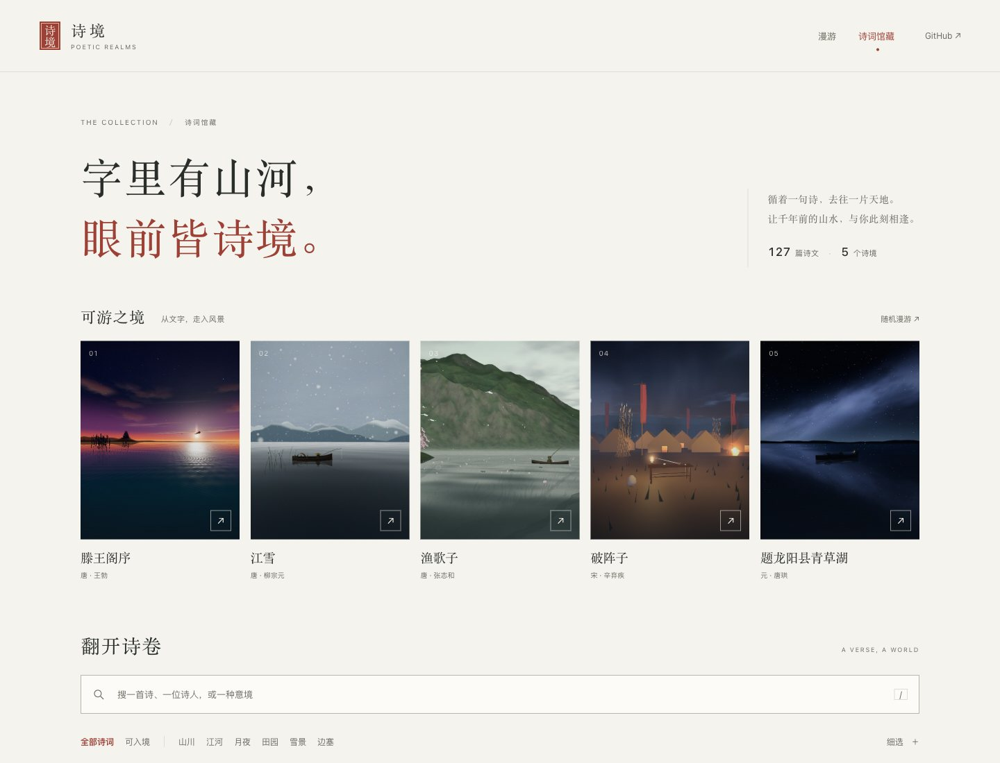
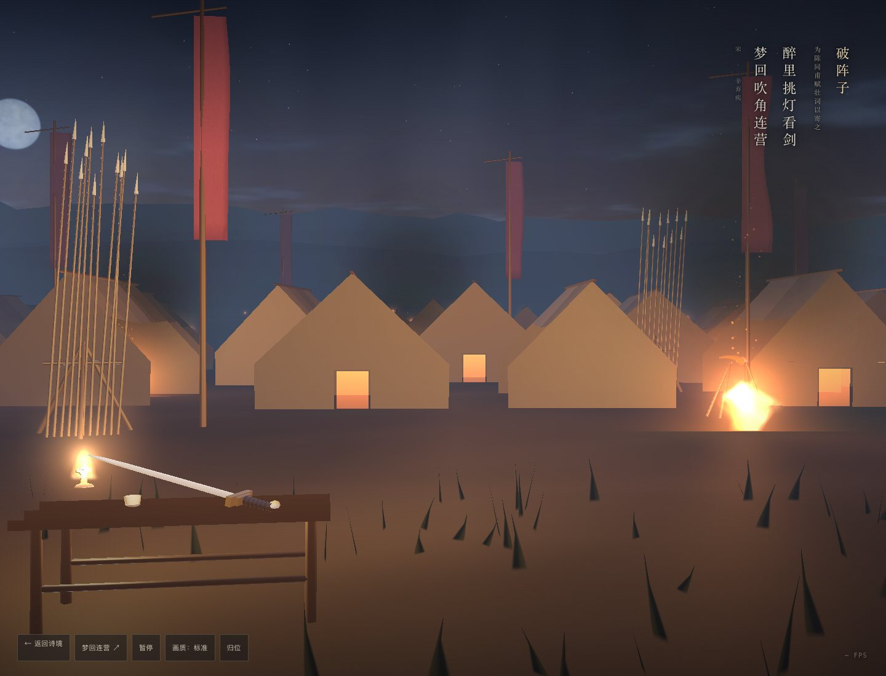

# 诗境界面重做与《破阵子》交付记录

日期：2026-10-30。单代理执行；本次续作模型为 GPT-6（Codex），浏览器工具为 Playwright CLI 0.1.22 / Chromium 156.0.8078.76。

## 界面与交互

- 首页保留全屏随机漫游，重做为场景主导的诗词放映厅。诗题简写、原文摘句与单一「邂逅下一境」主操作形成清晰层次；左右键、H、Esc 在画面获得焦点时仍有效。
- 馆藏以宣纸、墨色与朱砂组织排版。五幅封面直接截自仓库实际场景；保留全部 127 篇诗文和电子文本来源。领取模块、任务计数、认领链接及相关页面导航已移除。
- 搜索覆盖完整正文，朝代、意象、体裁、模型与工具筛选写入 URL。模型和工具取自实际版本信息；原型与发布版本均可用「可入境」筛选找到。
- 诗文详情使用原生 dialog，支持焦点圈定、Esc、焦点恢复与浏览历史。创作提示词和校勘信息按需展开，复制反馈位于对话框顶层。
- 展厅一次运行一个 iframe，支持版本切换、全屏、独立打开、全文阅读与出处说明。单版本时隐藏切换箭头，失败时提供恢复入口。



## 《破阵子》

路径：`scenes/pozhenzi/lamplight-sword.html`，版本 `lamplight-sword`，登记为 `prototype`。接续本地已有、尚未登记的草稿；原始草稿的模型未记录，本次不补造其作者信息。

文学依据沿用 `data/poems.json` 中辛弃疾《破阵子·为陈同甫赋壮词以寄之》的电子转录及来源，核心摘句为「醉里挑灯看剑，梦回吹角连营」。灯、剑、号角、营垒来自文本意象；月色、山形、器物造型与营帐布局为艺术加工，不声称历史复原，校勘状态仍为「待版本校勘」。

实现为手写 WebGL 1/2、GLSL ES 1.00 与原生 JavaScript，不加载外部库、贴图或接口。修正旌旗遗漏模型矩阵、粒子没有上传以及粒子四顶点中心坐标缺失的问题，打开帐门并补上帐内暖光。提供灯下与营垒视点切换、暂停、画质及归位；移动端限制 DPR、地形密度与粒子数。桌面流畅档支持 0.8 倍原生分辨率，避免 DPR=1 时自动降档失效。

源码按数学、WebGL 初始化、着色器、几何、地形、营帐、器物、粒子、装配、渲染和控制分别维护在 `scenes/pozhenzi/src/`，手写文件均在 500 行内。运行 `node scripts/pack-pozhenzi.mjs` 生成独立 HTML；浏览和部署不需要构建。CI 用 `--check` 核对成品与源码一致。

展厅负责观察 iframe 是否在父页面视口内，并以具名可见状态消息通知新场景；独立文件自行响应页面隐藏事件。作品不依赖站点脚本即可离线启动。



## 验证证据

以下命令实际通过：

```text
node scripts/validate.mjs
node scripts/test-agent-prompt.mjs
node scripts/test-gallery.mjs
node scripts/pack-pozhenzi.mjs --check
git diff --check
```

实际浏览器检查：

- 1440×1000 与 390×844 布局、五幅封面加载、127 篇检索、全文命中、模型筛选、空结果恢复、筛选 URL 恢复、前进后退。
- 详情焦点圈定、Esc、真实剪贴板内容与可见的复制反馈。
- 首页固定版本、上下境、iframe 内快捷键与静观；展厅首帧、全屏、移动阅读和单渲染器。
- 使用仅供浏览器验收的双版本数据验证切换及 URL；未将测试版本写入馆藏。
- 模拟目录 HTTP 503 后重试、目录失败时首页兜底、缺失场景 HTML、无场景诗文和无效链接。
- 在本地 `/Poetic-Realms/` 子目录检查资源与跳转；新场景滚出视口停止绘制，返回后恢复。
- 关闭网络后 `file://` 直接打开新场景；首帧、暂停/继续、视点、画质、WebGL 1 回退、无 WebGL 提示、context lost 与重新载入、减少动画设置。

正常流程没有捕获到控制台错误，WebGL 错误码为 0，每帧实际计数 17 次绘制调用。测试环境将新窗口与旧窗口同时报告为可见，因此后台逻辑使用模拟 `visibilitychange` 事件验证，未冒充真实后台标签页验收。

单实例、启动约 4.2 秒后的本机采样：

| 环境 | 浏览视口与 DPR | 实际画布 | 档位 | 采样帧率 |
| --- | --- | --- | --- | --- |
| macOS，AMD Radeon Pro 5500M，Chromium / ANGLE Metal | 1440×1000，DPR 1 | 1152×800 | 流畅 | 约 44.3 FPS |
| 同一桌面引擎，触控与移动视口模拟 | 390×844，DPR 3 | 390×844 | 流畅 | 约 60.0 FPS |

多个测试窗口同时渲染时也观察到约 21–32 FPS，帧率受显卡竞争与窗口状态影响。移动结果不代表真实手机、Safari 或其他 GPU 的性能；因此维持原型状态，不自动标为 published。既有 three.js 版本仍需要公共 CDN，新的《破阵子》不需要网络。

本记录描述本地代码和浏览器证据。GitHub 合并、CI 和线上部署状态以相应提交与运行记录为准。
