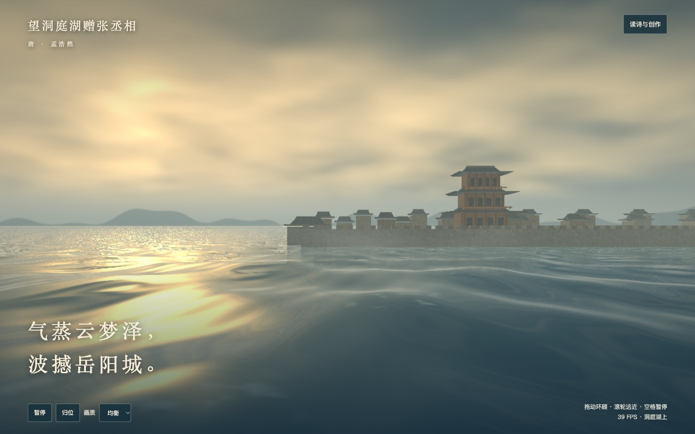
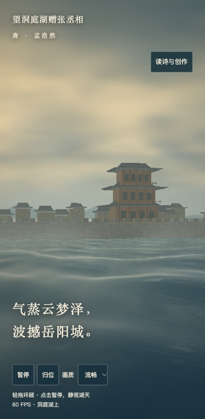

# 云梦蒸波 · 浏览器验收记录

作品：《望洞庭湖赠张丞相》，唐 · 孟浩然；作品 ID：`dongtinghu`。
版本：`clouds-over-dongting`，保持 `prototype`。模型：GPT-6（Codex；会话未提供更细构建号）。
Issue：目录的 `issueNumber` 为空，GitHub 未检索到对应可认领任务，未声称认领或修改任务状态。

## 实现与文学依据

- 单文件：`scenes/dongtinghu/clouds-over-dongting.html`，原生 WebGL 1.0、GLSL ES 1.00、JavaScript，无运行时外部依赖、远程素材或业务接口。
- 以空间视线求交绘制动态湖面，计算波面法线、菲涅耳反射、碎金高光与浪尖泡沫；云体沿视线分层采样三维噪声，远岸施加湿雾。
- 城墙、民居、重檐城楼为三维网格，统一合批；每帧湖天、城景倒影、城景共 3 次绘制。倒影为镜像网格加近似扰动，不是完整水下光传输。
- 三档画质限制分辨率、DPR 和云采样数（6 / 10 / 14）；手机默认流畅。支持暂停、拖动、滚轮、方向键、归位与减少动态偏好。
- 诗句支持湖天、蒸云、风浪、临水城阙。晨光、远山、城楼形制为艺术加工，不作唐代岳阳城历史复原。
- 正文使用目录电子转录，显示为简体；保留目录的“待版本校勘”状态。出处：[《全唐诗》社区电子转录](https://github.com/chinese-poetry/chinese-poetry/blob/master/%E5%85%A8%E5%94%90%E8%AF%97/poet.tang.7000.json)。

## 实测

日期：2026-10-31（Asia/Shanghai）。Playwright CLI 0.1.22，Node.js v24.22.1，macOS 26.7，AMD Radeon Pro 5500M / ANGLE Metal。帧率独立统计约 10 秒前台 requestAnimationFrame 间隔，单独运行当前场景；截图中的瞬时读数会波动。

| 环境 | CSS 视口 | 画布像素 | 画质 | 平均 FPS | 95% 帧间隔 |
| --- | --- | --- | --- | --- | --- |
| 桌面 Chrome 156，`file://` 离线打开 | 1440×900 | 1152×720 | 均衡 | 43.6（437 帧 / 约 10.03 秒） | 34.4 ms |
| Chromium，Pixel 7 / Android 14 触控模拟 | 412×839，DPR 2.625 | 412×839 | 流畅 | 60.0（600 帧 / 约 10.01 秒） | 18.6 ms |

移动行是在同一台电脑 GPU 上的浏览器模拟数据，**不是 Pixel 7 真机性能**；未覆盖 Safari / iOS 真机。WebKit 浏览器下载速度过慢，已取消，没有计入通过项。

已通过：

- `node scripts/validate.mjs`：127 首作品、127 份电子全文、89 条语料匹配、10 条任务引用、6 个场景版本。
- `git diff --check`；单文件 372 行，独立 HTML 可直接从 `file://` 加载，场景资源请求数 0。
- 桌面首帧、手机竖屏构图、题名/作者/摘句及全文面板；无水平溢出。正常路径控制台无错误/警告，`gl.getError() === 0`。
- 暂停后时间不变且无待执行 RAF；拖动、滚轮、方向键、空格、归位、画质切换；移动触控事件拖动及点按全文面板。
- 减少动态偏好初始静止。隐藏事件注入后停止 RAF；画廊真实隐藏 iframe 后由父页可见性消息停止渲染，恢复显示后继续。
- WebGL 不可用、Shader 编译失败、程序链接失败的故障注入均显示中文提示；`WEBGL_lose_context` 触发提示，重新打开恢复绘制。
- `gallery.html?poem=dongtinghu&scene=clouds-over-dongting` 正确读取目录、加载本版本；相对路径兼容仓库子目录。

已知局限：波浪与岸边泡沫采用视觉近似，没有流体碰撞模拟；倒影与远雾经过简化；低画质云体采样较稀，细节与边缘不如高画质；低端 GPU 仍可能需要流畅档。没有真机帧率与 Safari 兼容性结论。开发浏览器多标签切换未产生真实 `document.hidden`，此项只以事件注入和真实 iframe 可见性验证为证。

## 截图

