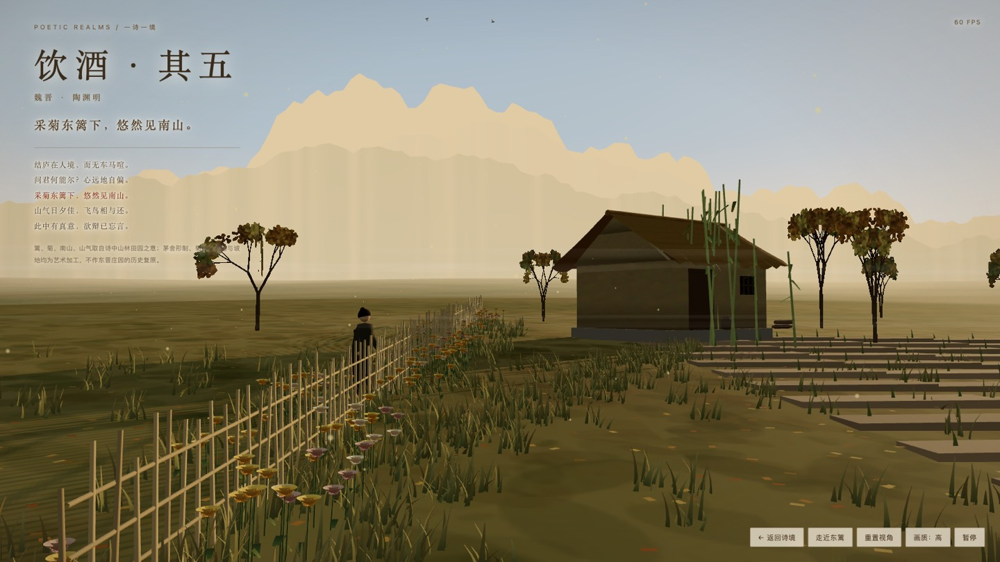
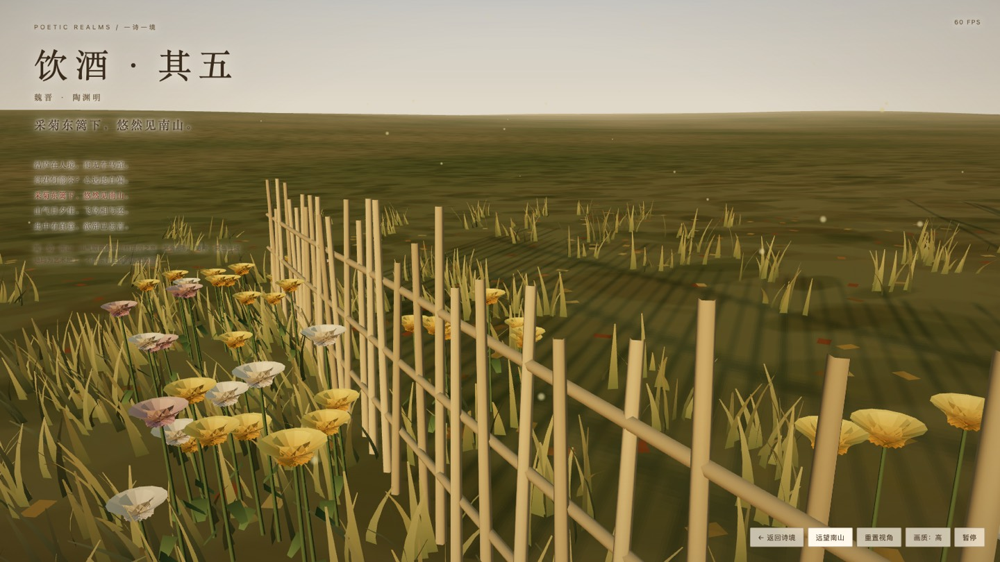

# 《饮酒·其五》东篱采菊 · 悠然见南山

2026-10-31，WorkBuddy（模型 MiniMax-M3.1-Flash）独立完成的《饮酒·其五》第三个三维诗境版本。

## 当前版本

- 诗文 ID：`yinjiu-wu`，版本：`east-fence-chrysanthemum`，题名：东篱采菊 · 悠然见南山。
- 成品：`scenes/yinjiu-wu/east-fence-chrysanthemum.html`，单文件自包含 HTML。
- `sceneStatus` 与版本状态均为 `prototype`，馆藏原文仍为「待版本校勘」。本次制作不作古籍校勘，也不声称东晋庄园的历史复原。
- 同首诗已有并行投稿的 `chrysanthemum-fence` 与 `east-fence-nanshan` 两个版本，按「一诗多境」规则并存，id 与 path 互不重复。

## 文学依据与艺术加工

原文取馆藏电子文本（《饮酒》二十首之其五，维基文库）。画面按诗句支持度分工：

- 「采菊东篱下」——竹篱笆（细竹桩三道横竿）与篱下一畦秋菊（金菊为主，间白菊、淡紫），篱边有一人俯身采菊。
- 「悠然见南山」——南面四层山影，主峰偏西，谷口升腾暮霭；四层按大气透视递减明度与饱和度。
- 「山气日夕佳」——傍晚低斜阳光，山脚与谷地叠六层雾带，地面留低雾。
- 「飞鸟相与还」——十二只鸟自西山一带斜飞回还，翅膀在顶点着色器里扑动。
- 「结庐在人境」——茅舍、土径、竹丛、园外菜畦，远处疏林。

以下属艺术加工，不作史实主张：茅舍形制与朝向、菊的品种与配色、菜畦布局、雾色浓淡、人物衣冠（素色长袍与髻）。

## 画面与实现

近景是东篱与菊畦，竹篱自画面左下斜向中景，视线顺着篱线指向山谷中的南山；右中是茅舍与菜畦；层叠山影与暖色天光构成远景。画面左上叠题名《饮酒·其五》、朝代作者、摘句与全诗，另有一行说明艺术加工边界，均不压住主体景物。

three.js r160 经 baomitu / bootcdn / jsdelivr 三个镜像依次动态 import，首个 10 秒不通即换下一个；不请求业务接口、不引用站点样式，贴图全部由 Canvas2D 程序化生成。

- 天空：着色器天穹，含日面、辉光与云带；深度测试开启、最后绘制，天空只着色可见像素。
- 地形：1200 米网格按解析函数起伏，南面渐抬形成谷口；顶点色区分枯草、干燥地块与踩踏土。
- 菊：花瓣两层环形加花心，金、白、淡紫三色变体；花梗与叶单独合批。
- 篱：细竹桩合并为单批次，三道横竿用带下垂的 Tube 曲线。
- 草木：草丛按簇生成并做风摆（顶点着色器改写位移）；落叶为合并的贴地小面片。
- 茅舍：墙、脊、瓦垄、门窗、柴堆、水瓮分件建模，草顶边缘做参差。
- 树：递归枝干 + 散点叶片程序化生成透明贴图，十字交叉片承载。
- 飞鸟：顶点着色器按 `aWing/aSide/aPhase` 绕纵轴扑翼。
- 雾带：半透明水平面，贴图随时间漂移。

移动端限制像素比、草量、菊瓣、雾层与阴影贴图尺寸，提供高／标准／省电三档；页面不可见时停止渲染；处理 WebGL 上下文丢失与着色器编译失败。

## 实测与检查

实际执行并通过：

```text
node scripts/validate.mjs
node scripts/pack-pozhenzi-three.mjs --check
node scripts/test-agent-prompt.mjs
node scripts/test-gallery.mjs
```

浏览器为 Google Chrome 156.0.8078.76（Playwright 驱动，headed，ANGLE Metal Renderer：AMD Radeon Pro 5500M）。

| 环境 | 视口 / DPR | 实际画布 | 帧率 | 备注 |
| --- | --- | --- | --- | --- |
| 桌面 | 1600×900 / 1 | 1600×900 | 55–60 FPS | 本机同时有其他并行任务跑 WebGL，实测在 20–60 FPS 间浮动，空载时稳定 60 FPS |
| 触控移动模拟 | 390×844 / 2 | 526×1139 | 48–52 FPS | 默认「标准」档，画布 DPR 上限 1.35 |

控制台无报错，无 shader 编译警告；首帧正常，拖拽、滚轮、双指缩放、走近东篱、重置视角、画质切换、暂停均可用。

## 已知缺陷

- 菊、竹篱、茅舍、人物均为程序化几何体，非写实扫描资产，近看缺少材质细节与接触阴影。
- 山体为分层剪影加顶点色，非真实高程场；近处山脊只有粗糙轮廓，没有树线贴图。
- 草与落叶不投射阴影，地面阴影来自茅舍、篱、树与人物（静态阴影贴图冻结，菊随风摆动但不入阴影）。
- 无音频（风声、虫鸣）与昼夜切换。
- 菜畦是几何体，长直线在近处略显人工。



