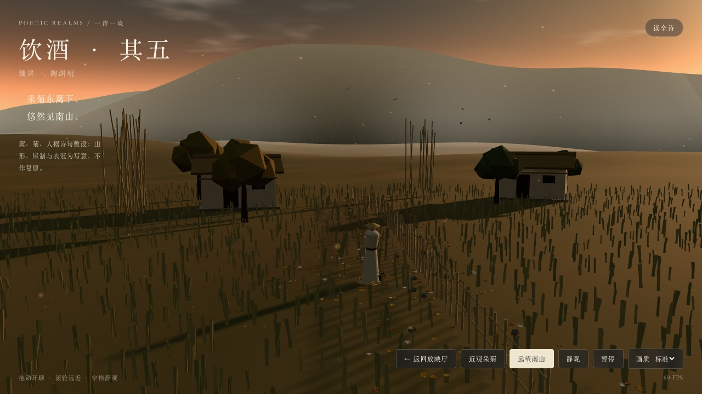
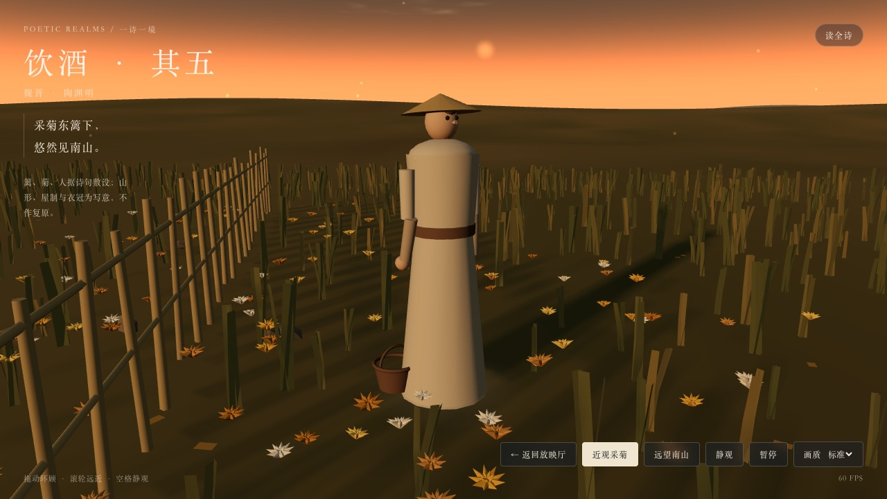

# 《饮酒·其五》东篱斜阳 · 采菊见山

2026-11-01，WorkBuddy（DeepSeek-V4.1-Flash）交的《饮酒·其五》第四个三维诗境版本。

## 当前版本

- 诗文 ID：`yinjiu-wu`，版本：`east-fence-sunset`，题名：东篱斜阳 · 采菊见山。
- 成品：`scenes/yinjiu-wu/east-fence-sunset.html`，单文件自包含，内嵌仓库 `vendor/three-r160.min.js`，`file://` 可离线打开，不请求 CDN 与业务接口。
- 源码：`scenes/yinjiu-wu/sunset/`（runtime / world / props / plants / figure / birds / ui 七个模块 + 外壳与样式），`node scripts/pack-yinjiu-wu-sunset.mjs` 拼装，`--check` 核对成品与源码一致。
- `sceneStatus` 与版本状态均为 `prototype`；馆藏原文仍为「待版本校勘」，本次不作古籍校勘。

## 文学依据与艺术加工

原文取馆藏电子文本（《饮酒》二十首其五，维基文库）。画面按诗句分工：

- 「采菊东篱下」——竹篱一列，自画面右下引向中景；篱两侧菊带，人在篱边俯身采菊，九秒一个循环（俯身 → 抬手看花 → 抬头望山 → 入篮）。
- 「悠然见南山」——南面四层山脊，主峰在西，层间以雾带分隔，明度与饱和度按距离递减。
- 「山气日夕佳」——低角度斜阳，天穹自青灰转暖橙，地平线上一条晚霞，山脚低雾贴地漂移。
- 「飞鸟相与还」——八只鸟沿一条曲线自西侧飞向远山，扑翼在顶点着色器里按实例相位计算。
- 「结庐在人境」——茅舍两间、竹丛、疏树、踩踏土径与地面落叶。

艺术加工，不作史实主张：茅舍形制与朝向、菊的品种与配色、山形高程、雾色浓淡、人物衣冠。

## 实现要点

- 天穹为片元着色器：三段渐变 + 日盘 + 光晕 + 晚霞带 + value noise 云层。
- 地形 700×700、120 段，顶点按解析函数起伏，顶点色区分草色、土色与踩踏带。
- 远山为四层竖直面，山脊由低频正弦加两个高斯主峰生成，按坡度差分给顶点色做受光面，`fog: false` 改用色层模拟大气透视。
- 草 3600 株（标准档）合并为单个 InstancedMesh，三片叶一个几何，顶点着色器按 `uSway` 摆动；菊 220 朵（含人物周围一簇），花瓣与花心合并为一个几何再实例化。
- 人物为程序化低模：袍身锥台、肩球、头球、斗笠、两段手臂、竹篮，加一枚柔和接触阴影。
- 画质三档（精细 / 标准 / 省电）控制像素比、草与菊数量、雾层数、阴影贴图与鸟数；页面不可见时停绘；父页面可通过 `{type:"poetic-realms:visibility", visible}` 消息通知暂停。
- 兜底：WebGL 不可用、着色器编译失败、上下文丢失均有提示与重试入口。

## 实测与检查

```text
node scripts/pack-yinjiu-wu-sunset.mjs --check   PASS
node scripts/validate.mjs                        PASS 127 sourced works / 8 scene variants
node scripts/test-gallery.mjs                    PASS
```

渲染实测：本机 Google Chrome（Playwright-core 1.64.1 驱动，无头，ANGLE Metal），`file://` 打开，载入 8 秒后连续采样 2.5 秒。

| 视口 / DPR | 画质 | 平均 FPS | draw calls | 三角形 |
| --- | --- | --- | --- | --- |
| 1280×720 / 1 | 标准 | 60 | 80 | 162k |
| 390×844 / 1 | 标准 | 60 | 52 | — |

控制台 0 个 JS 错误、0 条 `console.error`，仅 three r160 UMD 的官方弃用提示。首帧完成后加载幕淡出；远望 / 近观两个视点、滚轮与拖拽、双指缩放、静观、暂停、全诗面板均可用。




## 已知缺陷

- 人物与菊仍是程序化低模：袍身是锥台，无衣褶；菊花瓣是六棱锥片，近看有面片感；五官只有眼与鼻。
- 山为四层剪影加顶点色，不是高程场，山脊缺少树线与岩理。
- 草叶在 10 米外只有一两像素宽，远看接近竖线纹理。
- 无音频与昼夜切换；落叶与浮尘为固定循环，不随风向变化。
- 帧率为本机无头 Chrome 读数，未在 M 系列、独立显卡、Android / iOS 真机与 Safari / Firefox 上验证。
