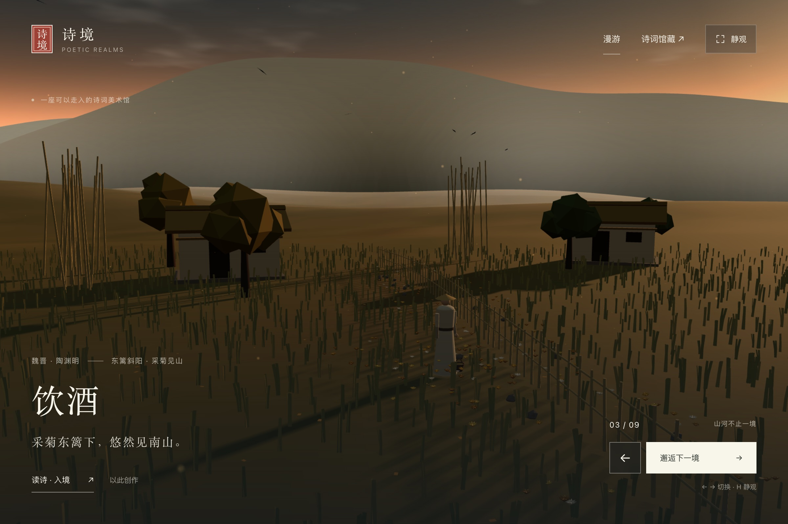
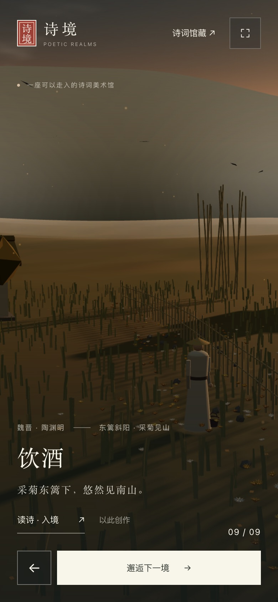

# 放映厅嵌入界面修复验收

日期：2026-11-02。任务来源：用户反馈的首页界面叠加截图；本次是公共展示层修复，没有新建场景或变更作品发布状态。

## 改动

- 放映厅在场景文档上设置 `data-poetic-realms-host="theater"`，通过 `assets/scene-embed.css` 统一收起作品自带题跋、工具栏和阅读面板。兼容当前 9 个版本，新作品可用 `data-scene-ui` 标记界面。
- 只启动选中的场景；嵌入样式加载完成后再显示 iframe，避免默认场景抢先启动或原工具栏闪出。
- 静观同时收起题名、导航和上一境／下一境。画面获得焦点后，放映厅在捕获阶段处理 H、Esc 和方向键。
- 独立打开与诗境展厅不启用放映厅模式，保留场景操作。加载提示、错误提示与重试入口不属于被收起的界面。
- 修复《饮酒·其五》东篱斜阳暂停后切换画质卡在加载幕的问题：允许暂停时绘制一帧，完成画质重建，保持动画暂停。

## 环境与结果

- 模型：GPT-6（Codex）。工具：原生 HTML/CSS/JavaScript、Three.js r160、Playwright CLI 0.1.23。
- 桌面：macOS，Google Chrome 156.0.8078.76；首轮操作检查 1440 × 1000，归档桌面截图 2400 × 1598 像素。
- 移动尺寸：同一 Chrome，390 × 844、DPR 2、触屏与移动设备模拟；没有 iOS／Android 真机验收证据。
- `node scripts/validate.mjs`：通过，127 篇、9 个已登记场景。
- `node scripts/pack-yinjiu-wu-sunset.mjs --check`：通过，独立 HTML 与模块源码一致。
- 逐一打开全部 9 个版本：画布可见、加载幕退出、自带标题及工具栏收起；该轮 JavaScript 错误与失败资源请求均为 0。
- 桌面 H／Esc、画面聚焦后左右切换、上一境按钮与静观显隐：通过。
- 移动尺寸：页面无溢出，静观触屏切换、进入展厅、展厅暂停：通过。
- 《饮酒》独立 HTML 经 `file://` 打开，近观、暂停、暂停后切换低画质、恢复播放与全文阅读：通过。切画质后暂停状态保留，动画时间未推进，加载幕关闭。
- 通过 WebGL 的 `WEBGL_lose_context` 扩展实际丢失上下文：错误提示及重新入境按钮可见；点击重试后首帧与嵌入布局恢复。
- 主动阻断嵌入样式请求：iframe 保持隐藏，保留读诗恢复入口；主动阻断目录请求：内置《江雪》正常显示，切换按钮禁用。
- Impeccable 检查提示现有 Logo 英文与元信息字号偏小；本次未新增该类字号。

## 截图

