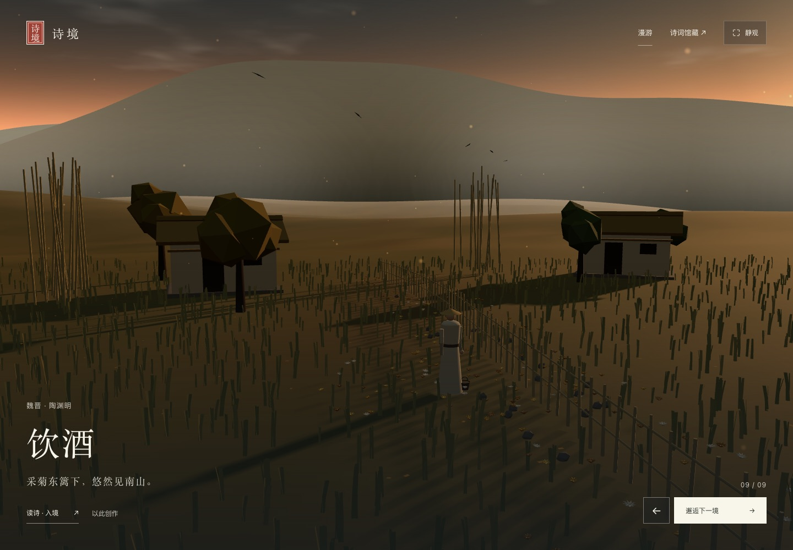
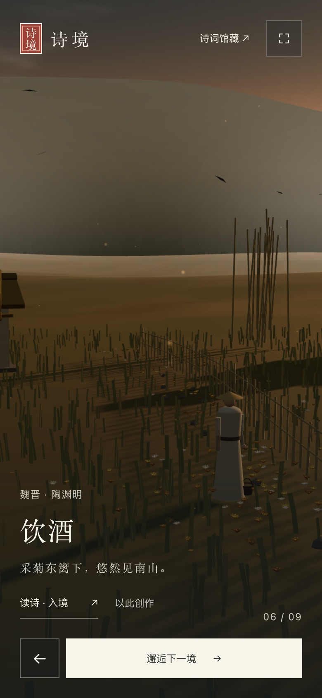

# 放映厅辅助小字精简

日期：2026-11-02。任务来源：用户要求去掉大量小字描述。范围为首页放映厅。

删除英文站名、宣传语、场景副标题、切换区标语与常驻快捷键说明；保留诗题、朝代与作者、诗句、数量及必要操作。作者信息桌面 13px、移动尺寸 12px，「以此创作」按钮增至 12px。对应无用样式与脚本节点访问一并删除。

模型：GPT-6（Codex）。工具：原生 HTML/CSS/JavaScript，Playwright CLI 0.1.23，macOS Chrome 156.0.8078.76。

验证结果：

- `node scripts/validate.mjs` 与 `git diff --check` 通过。
- Impeccable 对 `index.html` 的检查返回空数组。
- 实浏览器分别使用 1440 × 1000 桌面视口与 390 × 844、DPR 2 触屏模拟：五类辅助文案均已消失，作者信息保留、页面无溢出、静观显隐与上一境／下一境通过，JavaScript 与控制台错误均为 0。
- 移动端证据来自 Chrome 模拟，没有 iOS／Android 真机验收证据。

