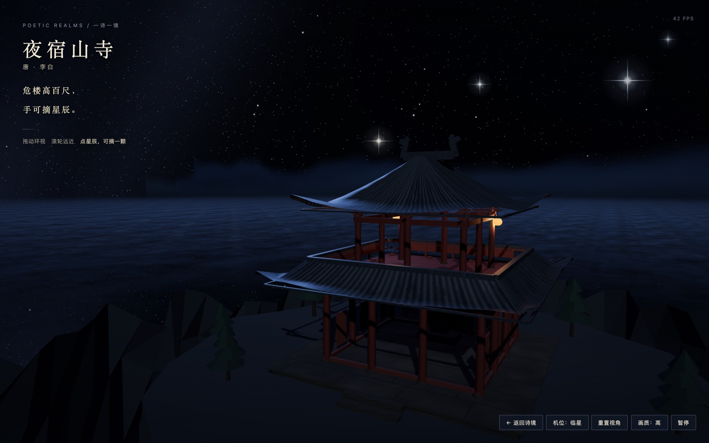
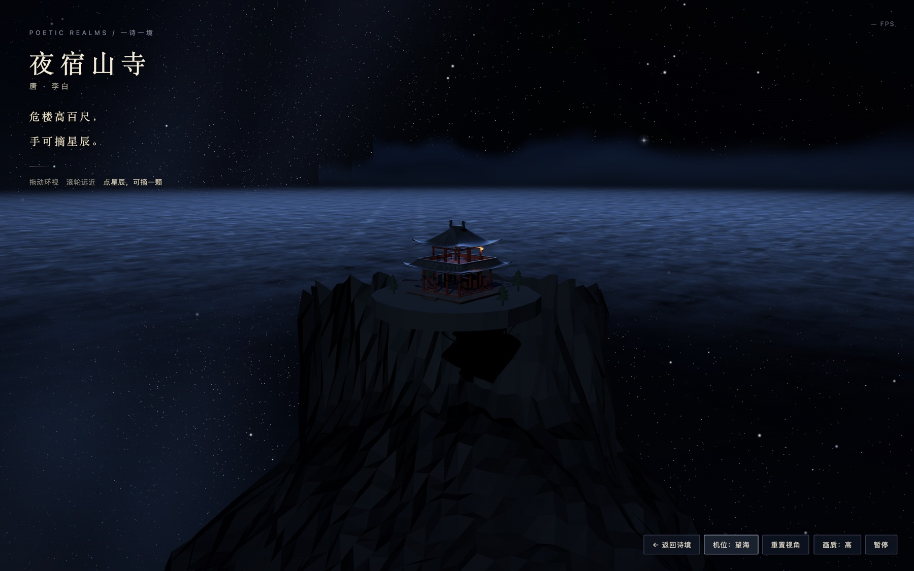
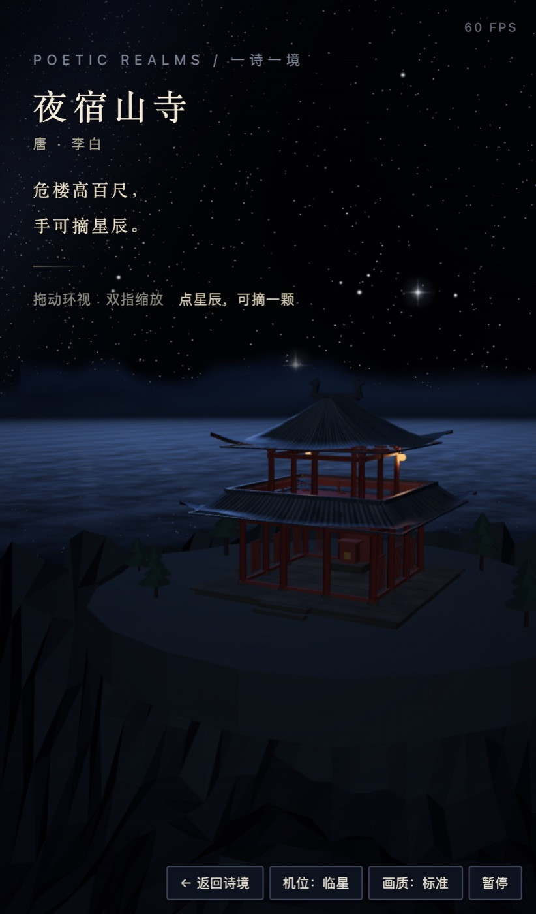

# 《夜宿山寺》危楼摘星 · 云海夜临

2026-11-02，WorkBuddy（DeepSeek-V4.1-Flash）交的《夜宿山寺》首个三维诗境版本。

## 当前版本

- 诗文 ID：`ye-su-shansi`，版本：`star-reaching-tower`，题名：危楼摘星 · 云海夜临。
- 成品：`scenes/ye-su-shansi/star-reaching-tower.html`，单文件 1466 行 64 KB，不依赖仓库其它文件。
- three.js r160 走公共 CDN（baomitu → bootcdn → jsdelivr，单镜像 10 秒超时即换下一个）。`file://` 直接打开实测可载入并出首帧；断网时给出提示，不静默黑屏。
- `sceneStatus` 与版本状态均为 `prototype`；原文仍为「待版本校勘」，本次不作古籍校勘。

## 文学依据与艺术加工

原文取馆藏电子文本，二十字两联，画面按句分工：

- 「危楼高百尺」——山巅一座重檐楼阁，台基 14 米见方，通高约 14.3 米（一层柱高 4.55 + 平坐 + 二层柱高 3.55 + 举折屋顶），楼外即崖，崖下三百余米是云海。楼阁是「高」的度量物，不是复原对象。
- 「手可摘星辰」——五颗近星悬在檐前 20 至 45 米处，带十字星芒与呼吸脉动；点它可摘，收拢成一次光晕扩散，三点四秒后原位重亮。这是全篇的核心交互。
- 「不敢高声语，恐惊天上人」——不作声音，只给静：无风铃声、无鸟叫，动效压到极慢（天球约四十分钟转一度，云海横移每秒数厘米），檐下两盏灯是画面里仅有的暖光。
- 天球按北纬三十度倾斜，银河大圆带在画面上方横过，星点分三层共五万四千余，按色温从蓝白到橙黄。

艺术加工，不作史实或天象主张：楼阁形制取唐以来楼阁式样的通行做法（重檐、斗拱、直棂窗、勾栏），具体比例、斗拱层数、瓦作与彩画均为程序化简化；山形、云高、星等、星辰与观者的实际距离都不作复原。

## 实现要点

- 屋顶为参数化四阿顶：檐口到脊线插 5 至 6 环，高度按 `t^1.30` 上翘形成举折，檐口按到角点的归一化距离加「缓翘 + 角部急翘」两层抬升并向外生出；另生成一圈垂直檐口裙边，让屋顶有厚度而不是一张纸。瓦垄为 Canvas 生成的 128 道垄纹，UV 沿周长走 1.15 遍，对应每垄约 0.3 米。
- 楼阁全部构件按材质合并为五个 BufferGeometry（石作、木作、暗色小件、瓦作、金饰），加灯笼与岩体共 40 个 draw call。
- 星空为三层 `Points` 加自定义着色器：背景层二万二千、银河带三万二千、亮星三百二十；闪烁在顶点着色器里按相位算，点大小固定在屏幕空间，不做距离衰减。
- 天空球是片元着色器：三段渐变 + 沿大圆的高斯辉光带 + 低频起伏 + 带内暗尘，不吃纹理。
- 云海六层水平面，各层用两张 512 的周期值噪声贴图做双速滚动，alpha 与颜色随视距变化（近暗远亮）；距离衰减放在片元里按世界坐标算，不是顶点插值。
- 远山四层竖直面，山脊高度存 512×1 的 `DataTexture`，片元按 uv 采样后 discard；渲染顺序排在云层之间，形成云绕山腰的层次。
- 月光 `DirectionalLight` 开 PCFSoft 阴影，因场景静止，`shadow.autoUpdate = false` 只烘一次。
- 画质三档（低 / 标准 / 高）控制像素比上限、云层数与星点绘制范围；另有自适应分辨率：连续掉到 50 帧以下就下调 0.09，回升到 58 帧以上再慢慢加回，横竖屏切换时按宽高比重算机位距离。
- 兜底：WebGL 不可用、CDN 全不通、着色器初始化失败、上下文丢失均有中文提示；页面不可见时停绘。

## 实测与检查

```text
node scripts/validate.mjs    PASS 127 sourced works / 10 scene variants
```

渲染实测：本机 MacBook Pro（AMD Radeon Pro 5500M），Google Chrome 无头驱动（Playwright 1.64.1，ANGLE Metal），`http://` 与 `file://` 两种方式各测一次。

| 视口 / DPR | 画质 | 平均 FPS | 实际像素比 | draw calls | 三角形 | 星点 |
| --- | --- | --- | --- | --- | --- | --- |
| 1440×900 / 2 | 高 | 59.9 | 1.95 | 40 | 35.9k | 54.3k |
| 1440×900 / 2 | 标准 | 60.1 | 1.55 | 40 | 17.9k | 39.1k |
| 390×844 / 3（iPhone 13） | 标准 | 60.3 | 1.55 | — | — | — |

控制台无 JS 错误、无 `console.error`，只有一次 favicon 的 404。首帧完成后加载幕淡出。拖拽环视、滚轮与双指缩放、三机位切换、画质切换、暂停、点星摘取均实测可用（摘星计数与底部提示已验证）。





## 已知缺陷

- 楼阁是程序化几何，没有 UV 展开的磨损、掉漆与苔痕；斗拱只有三跳，近看层次单薄。台基的条石砌缝靠贴图，转角处会拉伸。
- 云海是六层水平面叠加，掠射角下能看到重复纹理；没有体积云的自遮挡与厚度，云团边缘偏「平」。
- 远山是竖直面片，不是高程场，转动机位时山形不变、缺少视差。
- 山体是多边形棱角面（88 段 × 34 环），在近处能看到明显的长条折面。
- 星点总数为固定值，画质档只改绘制范围，低档下银河带会变稀疏而不是变细。
- 点星拾取按射线到星点中心的距离判定，星芒外缘点不中；移动端手指遮蔽下命中率一般。
- 帧率为本机无头 Chrome 读数，未在 M 系列、Windows 独显、Android / iOS 真机与 Safari / Firefox 上验证。
