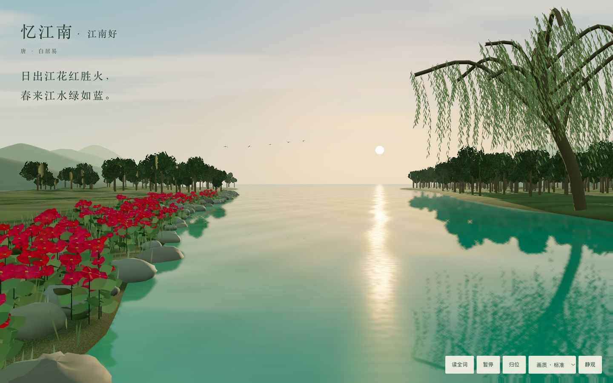
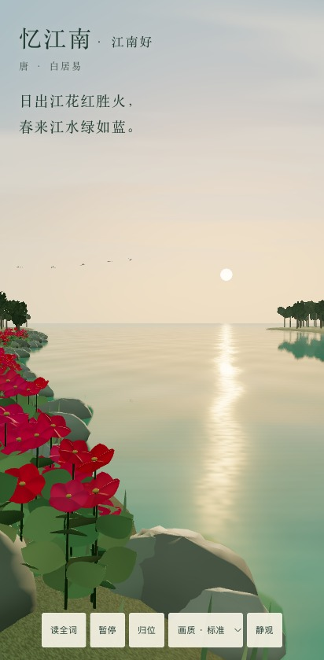

# 忆江南 · 春江初日（prototype）

对应 Issue #45；独立成品为 `scenes/yijiangnan/river-of-dawn.html`。

本版本以日出、江花和碧绿春水表现原句。三维网格水面结合场景平面反射、菲涅耳项、动态法线和日光高光；花瓣、岸石、远山及柳叶具有实际空间深度。冠层采用交错的透明叶簇片。花叶随风、远鸟振翼，日头缓慢升高。

题跋位于天空空白区。桌面与竖屏分别设置初始岸边视点，支持拖动环顾、滚轮或双指远近、暂停、归位、三档画质、静观及全文阅读。独立打开显示完整界面；放映厅通过 `data-scene-ui` 收起自带界面。

## 来源与维护

模型标识：GPT-6（Codex）；会话环境未提供更细的模型版本。

工具：three.js r160（仓库已有 MIT 发行包）、WebGL 2 / GLSL、Canvas 2D 程序化纹理；Node.js 24.22.1、Playwright CLI 0.1.23、Google Chrome 156.0.8078.82。

几何与纹理均由源码生成。three.js 及其 MIT 许可内置于成品，运行无外部资源请求。正文来源为 [chinese-poetry 的《憶江南 一》](https://github.com/chinese-poetry/chinese-poetry/blob/master/%E5%85%A8%E5%94%90%E8%AF%97/poet.tang.49000.json)，已核对电子转录；全文保留原有字形与标点，仍待古籍版本校勘。具体花种、河岸布局、柳树与鸟群为艺术加工。

维护源码在 `scenes/yijiangnan/dawn/`，按运行时、天空、地形、植物、水面、控制及界面拆分，每个手写文件不超过 500 行。成品由 `node scripts/pack-yijiangnan-dawn.mjs` 确定性拼装，`--check` 可检查源码与成品一致性。目录 JSON 保持既有序列化格式，追加一个版本并关联 Issue。

## 实测

实际 GPU 为 ANGLE Metal / AMD Radeon Pro 5500M（8 GB），macOS Intel 主机。下面两项均运行在该主机的 Chrome 上；Pixel 7 项是浏览器仿真，不代表手机硬件性能。

进入画面并预热 2 秒后，以实际主画面绘制计数除以采样时长计算平均帧率，采样约 10 秒。P95 为同时记录的帧间隔第 95 百分位。

| 场景 | 视口 / 实际 DPR | 绘制帧数 / 时长 | 平均 FPS | P95 帧间隔 | 本次首帧 |
| --- | --- | --- | --- | --- | --- |
| 桌面，标准画质，离线 file:// | 1440 × 900 / 1 | 594 / 10001 ms | 59.39 | 17.5 ms | 6303 ms |
| Pixel 7 竖屏仿真，标准画质 | 412 × 839 / 1（设备声明 2.625，已限制） | 600 / 10002 ms | 59.99 | 18.2 ms | 573 ms（缓存重载） |

两项均无应用控制台错误，无外部资源请求。引擎发行包每次载入会产生一条 three.js 弃用警告。

- 离线直接打开、首帧、原句与题名作者显示：通过。
- 暂停后 600 ms 内绘制计数与动画时间不变；暂停时拖动仍能改变视角：通过。
- 省电、标准、精细之间切换，保持暂停且正常重绘：通过。
- 全词阅读、静观、Esc 恢复、归位：通过。
- 通过 Chrome 触摸事件注入验证双指操作；暂停时相机重绘而动画时间不变：通过。
- 强制 WebGL context lost 后显示错误，恢复后重绘并保持原暂停状态：通过。
- 馆藏封面、展厅深链、自带题跋显示、放映厅界面收起及错误恢复入口可见：通过。
- 展厅可见性通知：拒绝错误布尔类型；隐藏时计数与时间停止，恢复时继续：通过。
- `validate.mjs`、新成品 `--check`、既有 three.js 成品检查、提示词检查和展厅检查：通过。

## 已知限制

程序化植被、石材和光照仍有简化，与摄影级材质存在差距。近岸阴影使用缓存，尚未随花叶风动逐帧更新。首帧受着色器编译与浏览器缓存影响，本轮观察到约 0.57–6.30 秒。

未进行手机真机、Safari / WebKit、WebGL 1 降级分支验收。真实设备是继续验证这些项目的条件。

源码已接入 Page Visibility 和 pagehide 停渲染。普通标签页后台测试中，本机自动化始终报告 `document.hidden=false`，未触发实际隐藏条件；因此不将该项标为实测通过。展厅的宿主通知停止与恢复已实测通过。普通后台页需要能触发真实隐藏状态的浏览器或设备进一步验收。

